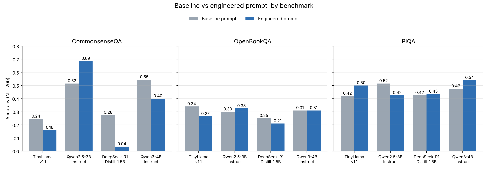

# Benchmark Evaluation of Open-Source LLMs with Prompt Engineering

I evaluated four small open-source large language models on three commonsense reasoning benchmarks. For each model, I compared a **baseline prompt** with an **engineered prompt** that adds a role, few-shot examples and an output constraint.

> Course project for **AI6130 – Large Language Models**, MSc Artificial Intelligence, Nanyang Technological University (NTU), Singapore.



## Highlights

- I built an evaluation pipeline with Hugging Face Transformers for **4 LLMs × 3 benchmarks × 2 prompting strategies** (24 settings, 200 questions each).
- The engineered prompt raised **Qwen2.5-3B-Instruct on CommonsenseQA from 51.5% to 68.5%** (+17 points) and **Qwen3-4B-Instruct on PIQA from 47.5% to 54.0%**.
- The same prompt **hurt** the smaller and distilled models. For example, DeepSeek-R1-Distill-1.5B fell from 27.5% to 3.5% on CommonsenseQA. How well prompt engineering works depends on the model.
- The answer parser handles reasoning models: it strips `<think>…</think>` blocks and extracts the final A–E choice from free-form output.

## Models and benchmarks

| Model | Type |
|---|---|
| [TinyLlama v1.1](https://huggingface.co/TinyLlama/TinyLlama_v1.1) | Small base model (1.1B) |
| [Qwen2.5-3B-Instruct](https://huggingface.co/Qwen/Qwen2.5-3B-Instruct) | Instruction-tuned (3B) |
| [DeepSeek-R1-Distill-Qwen-1.5B](https://huggingface.co/deepseek-ai/DeepSeek-R1-Distill-Qwen-1.5B) | Distilled reasoning model (1.5B) |
| [Qwen3-4B-Instruct-2507](https://huggingface.co/Qwen/Qwen3-4B-Instruct-2507) | Instruction-tuned (4B) |

| Benchmark | Tests | Format |
|---|---|---|
| CommonsenseQA | Everyday commonsense knowledge | 5-way multiple choice |
| OpenBookQA | Elementary science facts + reasoning | 4-way multiple choice |
| PIQA | Physical commonsense (how to do things) | 2-way multiple choice |

## Method

**Baseline prompt:** the question and its options, then `Answer:`

```
Question: Which object is used to cut paper?
Options: A: Spoon
B: Knife
C: Scissors
D: Plate
Answer:
```

**Engineered prompt:** three techniques combined:

1. **Role prompting:** "You are a specialized expert in commonsense qa."
2. **Few-shot examples:** two short worked examples that show the expected answer format.
3. **Output constraint:** "Provide ONLY the letter (A, B, C, D, or E) of the correct answer."

**Evaluation setup**

- The first 200 questions of each validation set. CommonsenseQA and OpenBookQA are loaded from the Hugging Face datasets `commonsense_qa` and `openbookqa`. PIQA is loaded from [`Open-Style/Open-LLM-Benchmark`](https://huggingface.co/datasets/Open-Style/Open-LLM-Benchmark).
- Models run in float16 with greedy decoding and up to 15 new tokens.
- Answer extraction: remove any `<think>` block, then take the last standalone letter A–E in the output.
- Metric: accuracy (correct ÷ 200).
- A pilot run with 50 questions per dataset checked the pipeline before the full run.

## Results (N = 200 per benchmark)

**Baseline prompt**

| Model | CommonsenseQA | OpenBookQA | PIQA |
|---|---|---|---|
| TinyLlama v1.1 | 0.245 | 0.340 | 0.420 |
| Qwen2.5-3B-Instruct | 0.515 | 0.300 | 0.515 |
| DeepSeek-R1-Distill-Qwen-1.5B | 0.275 | 0.250 | 0.425 |
| Qwen3-4B-Instruct-2507 | **0.545** | 0.310 | 0.475 |

**Engineered prompt**

| Model | CommonsenseQA | OpenBookQA | PIQA |
|---|---|---|---|
| TinyLlama v1.1 | 0.160 | 0.265 | 0.500 |
| Qwen2.5-3B-Instruct | **0.685** | **0.325** | 0.425 |
| DeepSeek-R1-Distill-Qwen-1.5B | 0.035 | 0.210 | 0.435 |
| Qwen3-4B-Instruct-2507 | 0.400 | 0.310 | **0.540** |

## Key findings

- **The instruction-tuned Qwen models performed best overall.** They follow structured prompts and few-shot formats more reliably.
- **Prompt engineering doesn't help every model.** The longer prompt confused the smaller base model (TinyLlama) and the distilled reasoning model (DeepSeek-R1-Distill). DeepSeek-R1 normally starts its output with a long reasoning block, so a short 15-token output limit probably cut many of its answers off before the final letter.
- **CommonsenseQA was the hardest and most prompt-sensitive benchmark.** It showed both the largest gain and the largest drop.

## Limitations and next steps

- I used 200-question subsets because of compute limits, so differences of a few points are within noise. Next step: run the full validation sets and report confidence intervals.
- The prompts were plain text and didn't use each model's chat template. Applying `tokenizer.apply_chat_template` would likely help the instruction-tuned and reasoning models.
- Next step: give reasoning models a larger token budget, and try chain-of-thought and task-specific few-shot examples.

## Repository structure

```
├── notebooks/
│   └── llm_benchmark_evaluation.ipynb   # full pipeline: warm-up, pilot (N=50), final run (N=200)
├── results/
│   └── accuracy_by_benchmark.png        # results chart
├── report/
│   └── AI6130_Benchmark_Evaluation_Report.pdf
├── requirements.txt
└── README.md
```

## How to run

1. Open `notebooks/llm_benchmark_evaluation.ipynb` in Google Colab, or in Jupyter on a machine with a GPU.
2. Choose a GPU runtime. I used an NVIDIA A100. A 16 GB GPU such as a T4 should also fit these models in float16, but it will run slower.
3. Run the cells in order. The final cell prints both results tables and saves the chart. The full run takes about an hour on an A100.

To install locally instead:

```bash
pip install -r requirements.txt
```

## Tech stack

Python · PyTorch · Hugging Face Transformers & Datasets · pandas · Matplotlib / Seaborn · Google Colab (A100)

## Author

**Veluchamy Punitha**, MSc Artificial Intelligence, NTU Singapore
